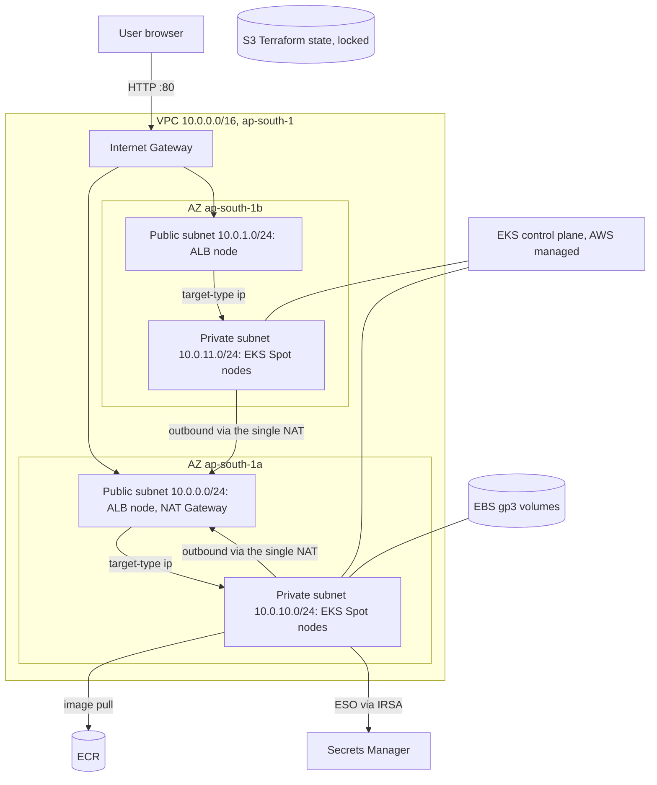
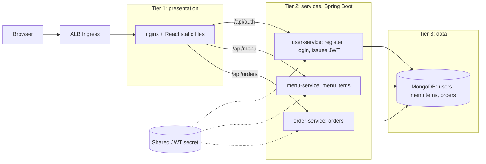
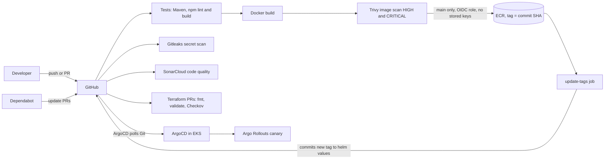

# FoodHub

**A cloud-native food-ordering platform on AWS EKS, delivered through a fully automated, security-scanned GitOps pipeline.**

It shows how to take three Spring Boot microservices and a React frontend from a `git push` to a running, observable, autoscaling Kubernetes deployment, with no long-lived AWS keys and no `kubectl` in CI, while keeping cloud cost near zero by destroying the infrastructure after each session.


---

## Table of contents

1. [Architecture](#1-architecture)
2. [Tech stack and AWS services](#2-tech-stack-and-aws-services)
3. [Repository structure](#3-repository-structure)
4. [Prerequisites](#4-prerequisites)
5. [Run locally](#5-run-locally)
6. [Deploy to AWS](#6-deploy-to-aws)
7. [Security and DevSecOps](#7-security-and-devsecops)
8. [Monitoring and observability](#8-monitoring-and-observability)
9. [Proof of work](#9-proof-of-work)
10. [Cleanup and cost control](#10-cleanup-and-cost-control)
11. [Design decisions, known gaps and lessons learned](#11-design-decisions-known-gaps-and-lessons-learned)

---

## 1. Architecture

### AWS network (VPC, subnets, NAT, ALB, EKS)



Application nodes and the database live in **private subnets**; only the ALB sits in public subnets. One shared NAT gateway is a deliberate cost trade-off (single point of failure for outbound traffic).

### Three-tier application



nginx is the single entry point and routes `/api/*` to the right service. The services never call each other: menu and order verify the JWT issued by user-service with the same signing secret.

### CI/CD and DevSecOps pipeline



More diagrams (Kubernetes internals, observability): [docs/architecture-aws.md](docs/architecture-aws.md).

---

## 2. Tech stack and AWS services

| Layer | Technology | Why |
|---|---|---|
| **Compute** | Amazon EKS 1.33, managed node group on **Spot** | Managed control plane; Spot cuts node cost by roughly 60 to 70 percent |
| **Compute** | Spring Boot 4.2 (Java 17), React + Vite, nginx | Three focused services plus a static frontend |
| **Networking** | VPC, 2 public and 2 private subnets across 2 AZs, Internet Gateway, one NAT Gateway | Private workloads, public ingress only |
| **Networking** | AWS Load Balancer Controller, ALB (target-type `ip`) | Kubernetes Ingress becomes a real ALB |
| **Database** | MongoDB 7 StatefulSet on EBS gp3 (EBS CSI driver) | Simple document store; persistent volumes |
| **Registry** | Amazon ECR (scan on push, immutable tags, keep last 10) | SHA-tagged, traceable images |
| **IaC** | Terraform (S3 backend with native lockfile), community VPC, EKS and IRSA modules | Reproducible, destroyable infrastructure |
| **CI/CD** | GitHub Actions with OIDC, Helm, ArgoCD, Argo Rollouts | Keyless AWS auth; GitOps; canary releases |
| **Security** | AWS Secrets Manager + External Secrets Operator, IRSA, NetworkPolicies, Kyverno, Trivy, Gitleaks, SonarCloud, Checkov, Dependabot | Defence at code, image, infrastructure and cluster level |
| **Scaling** | Horizontal Pod Autoscaler, Cluster Autoscaler | Pod and node elasticity |
| **Monitoring** | Prometheus, Grafana, Alertmanager (Slack), Loki + Alloy | Metrics, dashboards, alerts, logs |

**Not used** (stated plainly): ECS, Route 53, CloudFront, RDS, API Gateway, Redis, Jenkins, CloudWatch dashboards. There is no domain, so the app is served over **HTTP on the ALB address**.

---

## 3. Repository structure

```text
foodhub/
├── .github/
│   ├── workflows/
│   │   ├── ci.yml                 # test, scan, build, push to ECR, update tags
│   │   └── terraform.yml          # fmt, validate, Checkov on Terraform PRs
│   └── dependabot.yml
├── docs/
│   ├── architecture-aws.md        # detailed diagrams
│   ├── runbook.md                 # session routine and troubleshooting
│   ├── emergency-teardown.md      # safe destroy procedure
│   └── images/                    # screenshots
├── frontend/                      # React app, nginx.conf, Dockerfile
├── helm/
│   ├── springboot-service/        # shared chart (Rollout, HPA, Service, ServiceMonitor)
│   ├── user-service/ menu-service/ order-service/   # values per service
│   ├── frontend/                  # chart (Deployment, Service, Ingress)
│   └── mongodb/                   # StatefulSet chart
├── infra/terraform/
│   ├── bootstrap/                 # S3 state bucket (created once)
│   └── envs/dev/                  # VPC, EKS, IRSA roles, ECR, GitHub OIDC role
├── k8s/
│   ├── argocd/                    # ArgoCD Applications
│   ├── bootstrap/                 # install scripts for cluster add-ons
│   ├── secrets/                   # ExternalSecret manifests (pointers, no values)
│   ├── monitoring/                # Prometheus, Loki, Alloy values and alert rules
│   ├── network-policies/          # default deny + explicit allows
│   └── kyverno/                   # pod standards policy
├── services/
│   ├── user-service/ menu-service/ order-service/
├── docker-compose.yml             # full local stack
├── sonar-project.properties
├── .gitleaks.toml
└── .env.example
```

---

## 4. Prerequisites

Versions below are the ones this project was built and tested with.

| Tool | Tested version |
|---|---|
| AWS CLI | 2.42.1 |
| Terraform | 1.17.2 (needs 1.10 or newer for S3 native locking) |
| kubectl | 1.37.2 client |
| Helm | 3.22.1 |
| Docker | 29.x |
| Java / Maven | 17 / 3.9 |
| Node.js / npm | 20 / 10 |
| OS | Windows 11 with WSL2 Ubuntu |

**AWS account:** the project was built with an IAM user holding `AdministratorAccess`. For anyone else, a scoped policy covering EC2, VPC, EKS, ECR, IAM, S3, Secrets Manager, KMS and ELB is the better practice. Enable MFA on the root user and create a budget alarm before starting.

**Accounts and secrets you must create yourself:**
- GitHub repo (the OIDC trust policy is bound to the repo owner and repo IDs)
- SonarCloud project, with its token stored as the GitHub secret `SONAR_TOKEN` (add it under both **Actions** and **Dependabot** secrets)
- Slack incoming webhook (optional, for alerts)

---

## 5. Run locally

```bash
cp .env.example .env        # then set JWT_SECRET to a long random string
docker compose up -d
```

Open http://localhost:8080. Only the nginx frontend is published; the services and MongoDB sit on a private Docker network. Stop with `docker compose down`.

---

## 6. Deploy to AWS

> Costs about **$0.30 to $0.35 per hour** while the cluster runs. Read [section 10](#10-cleanup-and-cost-control) first.

### 6.1 One-time foundations

Edit these account-specific values for your own account: the S3 bucket name in `infra/terraform/envs/dev/versions.tf`, the role ARN in `.github/workflows/ci.yml`, ECR registry host names in `helm/*/values.yaml`, the GitHub repo in `iam-github.tf` and the owner and repo IDs in its trust policy.

```bash
# State bucket (created once, never destroyed)
cd infra/terraform/bootstrap
terraform init && terraform plan && terraform apply

# Secrets (values never touch Git)
aws secretsmanager create-secret --name foodhub/jwt \
  --secret-string "{\"JWT_SECRET\":\"$(openssl rand -base64 48 | tr -d '\n')\"}" --region ap-south-1
read -rs SLACK_URL    # then, as a separate command:
aws secretsmanager create-secret --name foodhub/slack-webhook \
  --secret-string "{\"url\":\"$SLACK_URL\"}" --region ap-south-1; unset SLACK_URL

# ECR and the GitHub OIDC role (cheap, kept between sessions)
cd ../envs/dev
terraform init
terraform apply \
  -target=aws_ecr_repository.app -target=aws_ecr_lifecycle_policy.app \
  -target=aws_iam_openid_connect_provider.github \
  -target=aws_iam_role.github_ci -target=aws_iam_role_policy.github_ci_ecr
```

### 6.2 Build images through the pipeline

Add the `SONAR_TOKEN` secret, then push a change outside `helm/` to `main`. The pipeline tests, scans, builds, pushes SHA-tagged images to ECR via OIDC, and a bot commits the new tag to `helm/*/values.yaml`. Wait until every job is green and run `git pull --rebase`.

### 6.3 Create the cluster

```bash
cd infra/terraform/envs/dev
terraform plan          # review before applying
terraform apply         # billing starts; takes 12 to 18 minutes
```

Five minutes later, check that nodes launched:

```bash
aws autoscaling describe-scaling-activities --query "Activities[0:3].[StatusCode,StatusMessage]" --output text
```

### 6.4 Install cluster add-ons and deploy

```bash
aws eks update-kubeconfig --name foodhub-dev --region ap-south-1
kubectl apply -f k8s/bootstrap/storageclass-gp3.yaml
./k8s/bootstrap/metrics-server.sh
./k8s/bootstrap/argocd.sh
./k8s/bootstrap/alb-controller.sh
./k8s/bootstrap/argo-rollouts.sh
./k8s/bootstrap/external-secrets.sh
kubectl create namespace foodhub
kubectl rollout status deployment/external-secrets-webhook -n external-secrets --timeout=180s
kubectl apply -f k8s/secrets/jwt.yaml
kubectl apply -f k8s/argocd/apps.yaml
```

ArgoCD then syncs MongoDB, the three services (as canary Rollouts with HPAs) and the frontend. Get the public address:

```bash
kubectl get ingress -n foodhub
```

Optional add-ons: `monitoring.sh`, `loki.sh`, `alloy.sh`, `cluster-autoscaler.sh`, `kubectl apply -f k8s/network-policies/foodhub.yaml`, `kubectl apply -f k8s/kyverno/policies.yaml`.

---

## 7. Security and DevSecOps

- **No long-lived AWS keys:** GitHub Actions authenticates through OIDC to a role that can only push to the four ECR repositories.
- **Secrets stay out of Git:** values live in AWS Secrets Manager; External Secrets syncs them into Kubernetes through a least-privilege IRSA role. Gitleaks scans history on every run.
- **Network isolation:** apps and database run in private subnets; the ALB is the only public entry. Kubernetes NetworkPolicies default-deny and allow only ALB to frontend, frontend to services, services to MongoDB (enforced by the VPC CNI).
- **Image security:** multi-stage builds, non-root users, dropped capabilities, Trivy blocks HIGH and CRITICAL fixable vulnerabilities, ECR scan on push, immutable SHA tags.
- **Code quality:** SonarCloud on every run.
- **Supply chain:** third-party GitHub Actions pinned to commit SHAs; Dependabot for Maven, npm, Docker, Actions and Terraform.
- **Infrastructure scanning:** Checkov on Terraform pull requests, with every skip documented in code.
- **State protection:** S3 state bucket is versioned, encrypted, private, TLS-only and uses native locking.
- **Cluster policy:** Kyverno ValidatingPolicy checks non-root, memory limits and no `latest` tag (Audit mode).

---

## 8. Monitoring and observability

| Signal | Tool | Access |
|---|---|---|
| Metrics | Prometheus scrapes each service's `/metrics` through ServiceMonitors | `kubectl port-forward svc/monitoring-kube-prometheus-prometheus -n monitoring 9090:9090` |
| Dashboards | Grafana | `kubectl port-forward svc/monitoring-grafana -n monitoring 3000:80` |
| Alerts | Alertmanager to Slack | webhook synced from Secrets Manager |
| Logs | Alloy to Loki, queried in Grafana Explore | `{namespace="foodhub"}` |

Grafana login is `admin`; the password is generated by the chart:

```bash
kubectl get secret monitoring-grafana -n monitoring -o jsonpath="{.data.admin-password}" | base64 -d; echo
```

Every service exposes `/health` (liveness and readiness probes at `/health/liveness` and `/health/readiness`) and `/metrics`. CloudWatch is not used, and MongoDB has no metrics exporter.

---

## 9. Proof of work

Screenshots live in `docs/images/`.

| What | Screenshot |
|---|---|
| Running web UI (menu, login, orders) |  |
| Green CI pipeline run |  |
| ArgoCD applications Synced and Healthy |  |
| EKS pods and nodes (`kubectl get pods,nodes`) |  |
| Grafana dashboard |  |
| Slack alert received |  |
| HPA scaling user-service from 2 to 4 pods |  |
| ECR repositories with SHA-tagged images |  |

---

## 10. Cleanup and cost control

**Never run a plain `terraform destroy`:** it also deletes ECR and the CI role. Always use the targeted destroy after releasing what Kubernetes created, otherwise the ALB, its `k8s-*` security groups and EBS volumes will block the VPC delete and keep billing.

```bash
# 1. Release resources created by controllers
kubectl delete -f k8s/argocd/apps.yaml --ignore-not-found
kubectl delete ingress --all -A
helm uninstall loki alloy monitoring -n monitoring      # if installed
kubectl delete pvc --all -A
kubectl get pv                                          # must be empty

# 2. Confirm the ALB and controller security groups are gone
aws elbv2 describe-load-balancers --query "LoadBalancers[].LoadBalancerName" --output text
aws ec2 describe-security-groups --filters "Name=group-name,Values=k8s-*" --query "SecurityGroups[].GroupId" --output text

# 3. Targeted destroy
cd infra/terraform/envs/dev
terraform destroy \
  -target=module.eks -target=aws_eks_addon.ebs_csi -target=module.ebs_csi_irsa \
  -target=module.alb_controller_irsa -target=module.eso_irsa \
  -target=module.cluster_autoscaler_irsa -target=module.vpc

# 4. Verify (all must print nothing)
aws eks list-clusters --output text
aws ec2 describe-nat-gateways --filter "Name=state,Values=available,pending" --query "NatGateways[].NatGatewayId" --output text
aws ec2 describe-addresses --query "Addresses[].PublicIp" --output text
aws ec2 describe-volumes --query "Volumes[].VolumeId" --output text
aws elbv2 describe-load-balancers --query "LoadBalancers[].LoadBalancerName" --output text
aws ec2 describe-vpcs --filters "Name=tag:Project,Values=foodhub" --query "Vpcs[].VpcId" --output text
```

**Remove everything permanently** (only when finished with the project):

```bash
cd infra/terraform/envs/dev && terraform destroy
aws secretsmanager delete-secret --secret-id foodhub/jwt --force-delete-without-recovery
aws secretsmanager delete-secret --secret-id foodhub/slack-webhook --force-delete-without-recovery
# then empty the versioned state bucket and run terraform destroy in infra/terraform/bootstrap
```

**Ongoing cost when nothing is running:** Secrets Manager (about $0.40 per secret per month), ECR storage and S3 (cents), plus any EKS KMS key still in its deletion window (up to about $1/month each).

---

Full troubleshooting table: [docs/runbook.md](docs/runbook.md).
