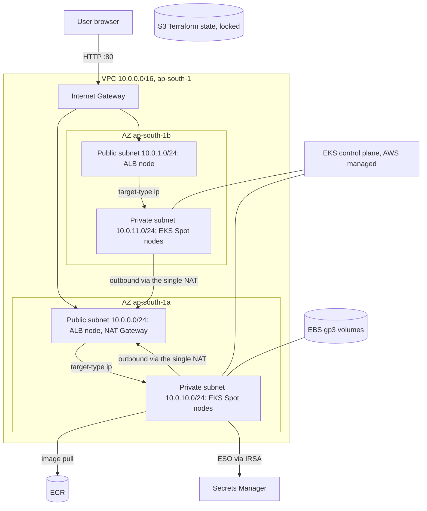
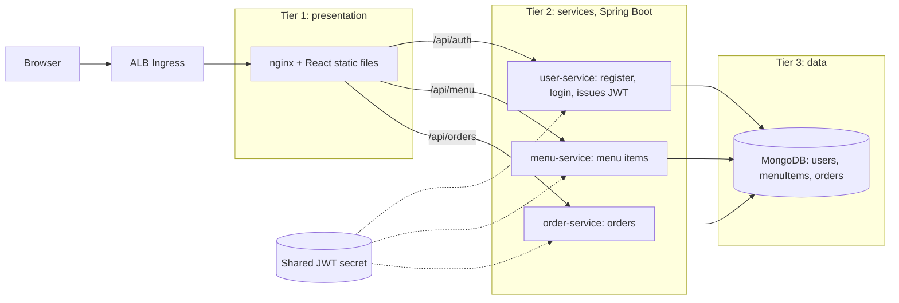
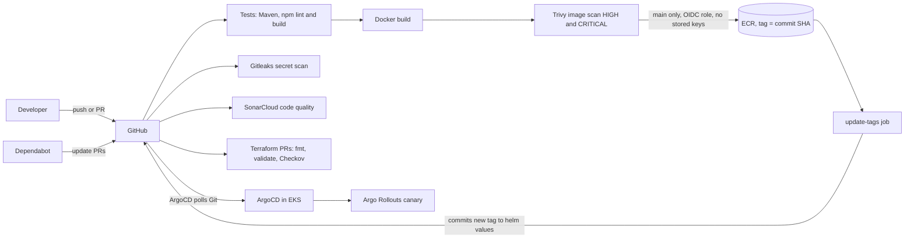
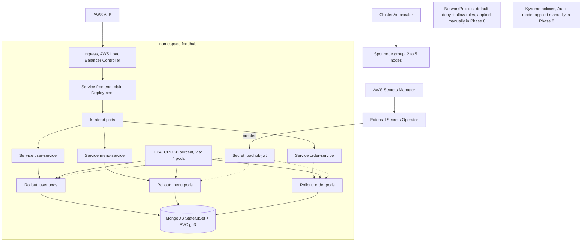
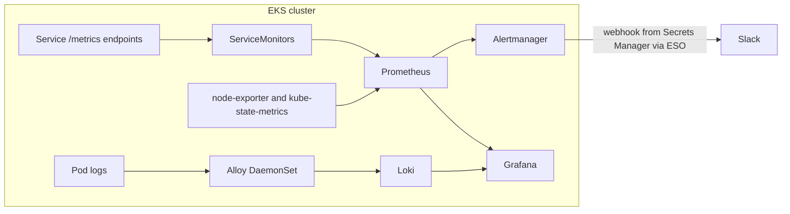

# FoodHub: detailed architecture

## 1. AWS cloud and VPC network

Not used: Route 53, CloudFront, RDS, ECS. One NAT gateway is a single point of failure, accepted for cost.

## 2. Three-tier application

Services never call each other. menu-service and order-service verify the JWT issued by user-service using the same secret. No API gateway, no cache.

## 3. CI/CD and DevSecOps (GitHub Actions + ArgoCD)

CI never runs kubectl and holds no cluster credentials. Pull requests skip the ECR push and tag commit.

## 4. Kubernetes (EKS)

Config comes from env vars in Helm values, so there are no ConfigMaps. Pods run non-root with dropped capabilities.

## 5. Monitoring, logging and observability

Metrics and logs for the services and nodes go to Prometheus and Loki, not CloudWatch. MongoDB has no exporter, so database metrics aren't collected.
