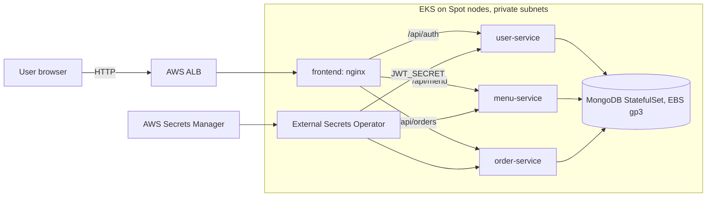
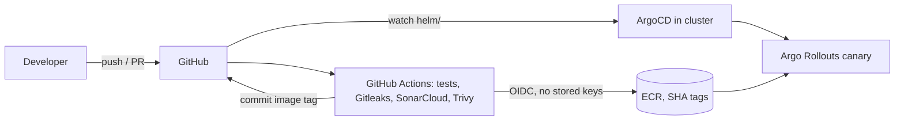
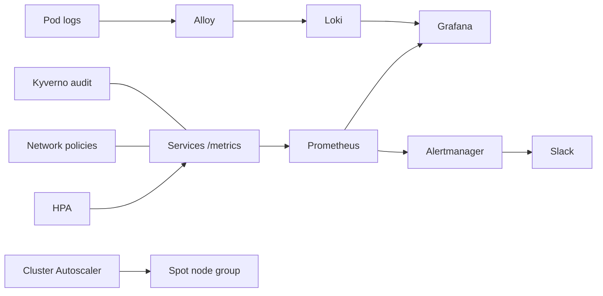

# FoodHub Architecture

## Runtime

## CI/CD and GitOps

## Observability and platform

## Infrastructure (Terraform)
- `bootstrap/`: S3 state bucket (versioned, encrypted, TLS-only).
- `envs/dev/`: VPC (2 public, 2 private subnets, one NAT), EKS, EBS CSI, IRSA roles, ECR, GitHub OIDC role.
- PR pipeline: fmt, validate, Checkov. Dependabot keeps dependencies current.
